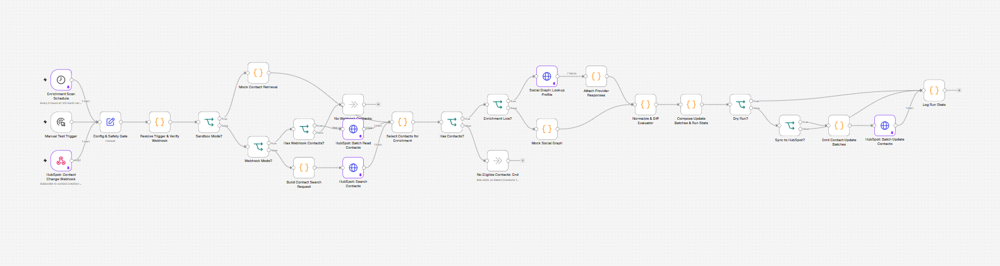

<div align="center">

# n8n-hubspot-contact-social-profile-enrichment-bridge

**Asynchronous enrichment workflow that takes raw HubSpot contact records, queries professional social graph APIs to verify active profiles, and updates avatar URLs and employment history.**

A dhRobin Systems Revenue Infrastructure blueprint

     

</div>

---

## Table of Contents

1. [Overview](#1-overview)
2. [Architecture](#2-architecture)
3. [Repository Contents](#3-repository-contents)
4. [Prerequisites](#4-prerequisites)
5. [5-Minute Sandbox Quick Start](#5-5-minute-sandbox-quick-start)
6. [Environment Variables](#6-environment-variables)
7. [Node-by-Node Configuration Guide](#7-node-by-node-configuration-guide)
8. [Provider Contract](#8-provider-contract)
9. [Normalisation and Diff Rules](#9-normalisation-and-diff-rules)
10. [Safety Matrix](#10-safety-matrix)
11. [Data Protection and Compliance](#11-data-protection-and-compliance)
12. [Deployment and Promotion Path](#12-deployment-and-promotion-path)
13. [Operations and Troubleshooting](#13-operations-and-troubleshooting)
14. [Disclaimer and License](#14-disclaimer-and-license)

---

## 1. Overview

Contact records decay: people change jobs, profile photos go stale, and a CRM full of former employees quietly wrecks routing and personalisation. I built this bridge to keep the professional layer of HubSpot contacts current, without letting a bad enrichment response destroy good data. It checks every contact against a licensed social graph provider, verifies that the returned profile really belongs to that contact, and writes only what is valid and actually different.

**The bridge runs in two modes:**

| Mode | Trigger | Selection |
|---|---|---|
| **Scan** | Schedule (every 2 hours) or Manual Test Trigger | CRM Search for contacts never checked, or last checked more than `RESCAN_DAYS` ago, optionally limited to target lifecycle stages |
| **Event** | HubSpot webhook (`contact.creation`, `contact.propertyChange` on email or profile URL) | The changed contacts, read with batch read |

**Per contact, the bridge:**

1. Applies eligibility rules: opt-out, a usable identifier, no personal emails sent to the provider, a recheck window, and the run cap.
2. Queries the provider with rate limiting (`BATCH_SIZE` requests per `RATE_LIMIT_DELAY_MS`), retries and per-contact error isolation.
3. Verifies identity (match status, confidence, profile URL and name) before using anything.
4. Validates the avatar URL, normalises employment history to structured JSON, and detects job changes.
5. Diffs against HubSpot. Empty or invalid incoming values never replace existing data.
6. Writes changes in HubSpot batch updates of up to 100 contacts, and logs a structured run summary.

**Design principles**

| Principle | Implementation |
|---|---|
| Safe by default | With no environment variables set, the bridge makes **zero external API calls and zero CRM writes**. |
| Never overwrite with less | Blank, invalid or rejected incoming values are skipped and counted as `fieldsProtected`. |
| Identity before data | Data is applied only for `matched` profiles above `MIN_MATCH_CONFIDENCE` whose profile URL and name agree with the contact. |
| Data minimisation | Only professional fields are stored. Personal email addresses are withheld from the provider by default. Opted-out contacts are skipped. |
| Integrity guard | If the provider returns a different number of responses than contacts sent, the run fails rather than risk attaching a profile to the wrong person. |
| Loop-safe | Webhook events caused by this integration's own writes (`sourceId = HUBSPOT_APP_ID`) are ignored. |
| Vendor-agnostic | One HTTP node and a documented contract ([§8](#8-provider-contract)). Swap providers without touching the diff logic. |
| Secrets out of data | `HUBSPOT_PRIVATE_APP_TOKEN` and `ENRICHMENT_API_KEY` appear only as `{{ $env.* }}` in HTTP header fields. |

---

## 2. Architecture

```mermaid
flowchart LR
    T1[Enrichment Scan Schedule<br/>23 */2 * * *] --> CFG
    T2[Manual Test Trigger] --> CFG
    T3[HubSpot: Contact<br/>Change Webhook] --> CFG
    CFG[Config & Safety Gate<br/>$env → config.*] --> RT[Resolve Trigger &<br/>Verify Webhook<br/>scan / webhook · HMAC · loop guard]
    RT --> SB{Sandbox Mode?}
    SB -- yes --> MC[Mock Contact Retrieval]
    SB -- no --> WM{Webhook Mode?}
    WM -- yes --> HW{Has Webhook<br/>Contacts?}
    HW -- yes --> BR[HubSpot: Batch<br/>Read Contacts]
    HW -- no --> NW[No Webhook<br/>Contacts: End]
    WM -- no --> BS[Build Contact<br/>Search Request] --> SC[HubSpot: Search Contacts<br/>paginated, capped]
    MC --> SE[Select Contacts<br/>for Enrichment]
    BR --> SE
    SC --> SE
    SE --> HC{Has Contacts?}
    HC -- no --> NE[No Eligible<br/>Contacts: End]
    HC -- yes --> EL{Enrichment Live?}
    EL -- yes --> SG[Social Graph:<br/>Lookup Profile<br/>rate-limited] --> AT[Attach Provider<br/>Responses<br/>count guard]
    EL -- no --> MG[Mock Social Graph]
    AT --> DF[Normalize &<br/>Diff Evaluator]
    MG --> DF
    DF --> CP[Compose Update<br/>Batches & Run Stats]
    CP --> DR{Dry Run?}
    DR -- yes --> LG[Log Run Stats]
    DR -- no --> SY{Sync to HubSpot?}
    SY -- no --> LG
    SY -- yes --> EB[Emit Contact<br/>Update Batches] --> BU[HubSpot: Batch<br/>Update Contacts] --> LG
```





### Stage contracts

| Stage | Output |
|---|---|
| Resolve Trigger & Verify Webhook | `{ mode: "scan" \| "webhook", contactIds[], forcedIds[], counters, signature }` |
| Mock Contact Retrieval / Batch Read / Search | HubSpot response shape: `{ results: [{ id, properties }] }` |
| Select Contacts for Enrichment | One item per contact: `{ contactId, existing, identity{ firstName, lastName, profileUrl }, requestBody, selectStats }` |
| Attach Provider Responses / Mock Social Graph | `{ …contact, provider: { httpStatus, error, body } }` |
| Normalize & Diff Evaluator | One item: `{ stats, results: [{ contactId, status, reason, confidence, contentChanged, changedFields[], protectedFields[], jobChange, notes[], update }] }` |
| Compose Update Batches & Run Stats | One item: `{ dryRun, syncToHubspot, circuitBreaker, counts, updateBatches[][], runStats, results[] }` |
| Log Run Stats | One item: `{ outcome, runId, mode, selection, enrichmentStats, jobChanges[], plannedUpdates, hubspotWrites, circuitBreaker, finishedAt }` |

---

## 3. Repository Contents

```
n8n-hubspot-contact-social-profile-enrichment-bridge/
├── README.md        Technical documentation (this file)
├── workflow.json    Importable n8n workflow with sticky notes and pinned synthetic payloads
├── DISCLAIMER.md    Liability limitation and usage terms
└── LICENSE          MIT License
```

---

## 4. Prerequisites

| Requirement | Detail |
|---|---|
| n8n | Self-hosted **1.60 or later** (Schedule Trigger 1.2, Webhook 2, Set 3.4, IF 2, Code 2, HTTP Request 4.2, `v1` execution order). |
| Env access | `N8N_BLOCK_ENV_ACCESS_IN_NODE=false`. Recent n8n releases block `$env` in nodes by default, so set this explicitly. |
| Crypto in Code nodes | `NODE_FUNCTION_ALLOW_BUILTIN=crypto` for webhook signature verification. |
| HubSpot app | Scopes `crm.objects.contacts.read` and `crm.objects.contacts.write`. For event mode, a webhook subscription to `contact.creation` and `contact.propertyChange` (email, profile URL property), plus the app's client secret. |
| HubSpot properties | Twelve custom contact properties (see [§7.13](#713-hubspot-custom-contact-properties)). |
| Enrichment provider | A **licensed** professional profile or social graph API whose terms permit this use, adapted to the contract in [§8](#8-provider-contract). Do not connect scraping services. Professional networks generally prohibit automated collection from their sites. |

> **n8n Cloud:** you can't define your own environment variables on n8n Cloud. Replace each `$env.X` with `$vars.X` (on plans with Variables) or move the secret into an n8n credential. The node logic is unchanged.

---

## 5. 5-Minute Sandbox Quick Start

1. **Run n8n locally:**
   ```bash
   docker run -it --rm -p 5678:5678 \
     -e N8N_BLOCK_ENV_ACCESS_IN_NODE=false \
     -e NODE_FUNCTION_ALLOW_BUILTIN=crypto \
     -e GENERIC_TIMEZONE=UTC \
     -v n8n_data:/home/node/.n8n \
     docker.n8n.io/n8nio/n8n
   ```
2. **Import** `workflow.json` (*Workflows → Import from File*).
3. Click **Test workflow** on *Manual Test Trigger*.
4. Open **Normalize & Diff Evaluator** and **Log Run Stats**, and inspect `results`, `updateBatches` and `runStats`.

**Expected sandbox result** (nine synthetic contacts, no credentials, nothing sent):

| Contact | Outcome | Why |
|---|---|---|
| Alex Mercer | `active`: 7 fields written | Verified profile. Avatar, headline, current role and 3-entry history added |
| Priya Natarajan | `active`: **job change** detected | Provider shows a new current company. `jobtitle` is not overwritten (`fill_empty`) |
| Jordan Ellis | `active`: 6 fields **protected** | Provider returned empty avatar and history. Existing values kept |
| Sam Okafor | skipped (`noIdentifier`) | Personal email withheld from the provider, and no profile URL |
| Riley Chen | `not_found` | Status and timestamp only, retried after `RESCAN_DAYS` |
| Morgan Blake | `mismatch` | The profile URL returned differs from the one in HubSpot. No data applied |
| Casey Novak | skipped (`optedOut`) | `social_enrichment_opt_out = true` |
| Taylor Brooks | `ambiguous` | Confidence 0.55, below `MIN_MATCH_CONFIDENCE` |
| Avery Quinn | `active`: **avatar rejected** | A `data:` URI is not a valid avatar URL. Other fields were written, and `jobtitle` and `company` were filled because they were empty |

Running from the webhook node instead (it has a pinned synthetic event batch) shows the event path: nine `contact.creation` events are accepted, one event caused by the bridge's own write is ignored, and one change to an unwatched property is ignored.

---

## 6. Environment Variables

All variables are optional. Unset values resolve to the safest behaviour.

### 6.1 Safety gate

| Variable | Default | Behaviour |
|---|---|---|
| `SANDBOX_MODE` | `true` | Any value except `false` uses synthetic contacts and provider. Zero external calls. |
| `DRY_RUN` | `true` | Any value except `false` computes updates and ends at *Log Run Stats* without writing. |
| `SYNC_TO_HUBSPOT` | `false` | Must be exactly `true` (with `DRY_RUN=false` and the breaker closed) to write contacts. |
| `ENRICHMENT_MODE` | `mock` | `live` calls the provider. Ignored while `SANDBOX_MODE` is on. |
| `REQUIRE_HUBSPOT_SIGNATURE` | `true` | Any value except `false` rejects unsigned webhook requests. Skipped only in sandbox. |
| `MAX_PROVIDER_ERROR_PCT` | `50` | Circuit breaker: with 10 or more lookups, a higher error rate blocks writes. |

### 6.2 Provider and rate limiting

| Variable | Default | Description |
|---|---|---|
| `ENRICHMENT_API_URL` | `https://api.social-graph.example/v1/person/lookup` | Provider lookup endpoint. Not a secret. |
| `ENRICHMENT_API_KEY` | — | **Secret.** Sent only in the auth header. |
| `ENRICHMENT_AUTH_HEADER` | `Authorization` | Header name, for example `X-Api-Key`. |
| `ENRICHMENT_AUTH_PREFIX` | `Bearer ` | Prefix placed before the key. Set it to an empty string for raw keys. |
| `BATCH_SIZE` | `5` | Requests sent per interval (1–50). |
| `RATE_LIMIT_DELAY_MS` | `1000` | Interval between request groups (100–60,000 ms). The default is about 5 requests per second. |
| `MAX_CONTACTS_PER_RUN` | `200` | Contacts processed per run (1–1,000). Webhook batch reads are capped at 100 per request. |

### 6.3 Selection

| Variable | Default | Description |
|---|---|---|
| `TARGET_LIFECYCLE_STAGES` | *(all)* | Comma-separated internal values, for example `lead,marketingqualifiedlead,salesqualifiedlead,opportunity,customer`. |
| `RESCAN_DAYS` | `30` | Scan mode re-checks contacts last checked longer ago than this. |
| `MIN_RECHECK_HOURS` | `24` | Webhook mode skips contacts checked within this window, unless the profile URL itself changed. |
| `SEND_PERSONAL_EMAILS` | `false` | When `false`, free-mail addresses are never sent to the provider. |
| `EXTRA_PERSONAL_EMAIL_DOMAINS` | *(empty)* | Additional domains treated as personal. |
| `LINKEDIN_URL_PROPERTY` | `linkedin_profile_url` | Contact property holding the professional profile URL. |
| `WATCH_PROPERTIES` | `email,<LINKEDIN_URL_PROPERTY>` | `propertyChange` events for these properties trigger enrichment. |
| `HUBSPOT_APP_ID` | *(empty)* | Your app ID. Events with this `sourceId` (the bridge's own writes) are ignored. |
| `HUBSPOT_WEBHOOK_PUBLIC_URL` | *(webhook URL)* | Exact public URL HubSpot calls, used for signature verification behind proxies. |

### 6.4 Normalisation and writes

| Variable | Default | Description |
|---|---|---|
| `MIN_MATCH_CONFIDENCE` | `0.8` | Minimum provider confidence to apply data (0.5–1). |
| `ALLOWED_AVATAR_HOSTS` | *(any HTTPS host)* | Comma-separated host allowlist for avatar URLs, for example your provider's CDN. |
| `EMPLOYMENT_HISTORY_MAX` | `5` | Positions kept in `social_employment_history_json`. |
| `STANDARD_FIELD_POLICY` | `fill_empty` | `never`: never touch `jobtitle` or `company`. `fill_empty`: fill them only when blank. `overwrite`: replace them with the verified current role. |
| `HUBSPOT_BATCH_SIZE` | `100` | Contacts per batch update (≤ 100). |
| `HUBSPOT_API_BASE_URL` | `https://api.hubapi.com` | API base. |

### 6.5 Secrets

| Variable | Used by | Placement |
|---|---|---|
| `HUBSPOT_PRIVATE_APP_TOKEN` | All HubSpot nodes | `Authorization: Bearer …` header |
| `ENRICHMENT_API_KEY` | Social Graph: Lookup Profile | `ENRICHMENT_AUTH_HEADER` header |
| `HUBSPOT_APP_CLIENT_SECRET` | Resolve Trigger & Verify Webhook | Read in memory for the HMAC check only, never output. This is the single sanctioned exception, because an HMAC can't be computed in a header field. |

### 6.6 Sample `.env` (staging)

```dotenv
# n8n runtime
N8N_BLOCK_ENV_ACCESS_IN_NODE=false
NODE_FUNCTION_ALLOW_BUILTIN=crypto
GENERIC_TIMEZONE=UTC

# Safety gate: live provider against a HubSpot test portal, nothing written yet
SANDBOX_MODE=false
ENRICHMENT_MODE=live
DRY_RUN=true
SYNC_TO_HUBSPOT=false
REQUIRE_HUBSPOT_SIGNATURE=true

# Secrets (inject from your secret manager; never commit)
HUBSPOT_PRIVATE_APP_TOKEN=replace-with-test-portal-token
HUBSPOT_APP_CLIENT_SECRET=replace-with-app-client-secret
ENRICHMENT_API_KEY=replace-with-provider-key

# Provider
ENRICHMENT_API_URL=https://api.social-graph.example/v1/person/lookup
ENRICHMENT_AUTH_HEADER=Authorization
ENRICHMENT_AUTH_PREFIX=Bearer 
BATCH_SIZE=5
RATE_LIMIT_DELAY_MS=1000
MAX_CONTACTS_PER_RUN=200

# Selection and writes
TARGET_LIFECYCLE_STAGES=lead,marketingqualifiedlead,salesqualifiedlead,opportunity
RESCAN_DAYS=30
MIN_MATCH_CONFIDENCE=0.85
ALLOWED_AVATAR_HOSTS=media.social-graph.example
STANDARD_FIELD_POLICY=fill_empty
HUBSPOT_APP_ID=5200001
```

---

## 7. Node-by-Node Configuration Guide

### 7.1 Triggers
| Node | Detail |
|---|---|
| Enrichment Scan Schedule | Cron `23 */2 * * *` (every 2 hours at :23). Each run processes up to `MAX_CONTACTS_PER_RUN`, so the backlog drains gradually and stays within provider quotas. **Pinned.** |
| Manual Test Trigger | Same pipeline in scan mode. |
| HubSpot: Contact Change Webhook | `POST /webhook/hubspot/contact-enrichment`, responds 200 immediately. Subscribe your app to `contact.creation` and `contact.propertyChange` for `email` and the profile URL property. **Pinned:** a synthetic batch of 11 events. |

The workflow imports **inactive**. Activate it only after completing [§12.2](#122-promotion-path).

### 7.2 Config & Safety Gate
Set v3.4 with *Include Other Fields*, so webhook request fields pass through. It holds typed, non-secret configuration under `config.*`. Safety flags stay on unless set to exactly `false`, write flags stay off unless set to exactly `true`, and numbers are clamped. `enrichmentLive` is `false` whenever `SANDBOX_MODE` is on.

### 7.3 Resolve Trigger & Verify Webhook
| Step | Detail |
|---|---|
| Mode | A request with `body` and `headers` → `webhook`. Otherwise → `scan`. |
| Signature | HubSpot v3: `base64(HMAC-SHA256(secret, "POST" + uri + body + timestamp))`, compared with `timingSafeEqual`. Requests outside a 5-minute window are rejected. |
| Filtering | Keeps `contact.creation`, and `contact.propertyChange` for `WATCH_PROPERTIES`. |
| Loop guard | Drops events whose `sourceId` equals `HUBSPOT_APP_ID`. These are the bridge's own writes. |
| Forced recheck | A change to the profile URL property bypasses `MIN_RECHECK_HOURS`. |
| Counters | `received`, `ignoredType`, `ignoredProperty`, `selfInflicted`, `duplicate`. |

### 7.4 HubSpot: Batch Read Contacts (webhook mode)
`POST /crm/v3/objects/contacts/batch/read` with the configured property list and up to 100 contact IDs. **Pinned:** nine synthetic contacts.

### 7.5 Build Contact Search Request → HubSpot: Search Contacts (scan mode)
- Filter groups: `social_enrichment_last_checked_at NOT_HAS_PROPERTY`, **or** `social_enrichment_last_checked_at < now − RESCAN_DAYS`, each optionally restricted to `lifecyclestage IN TARGET_LIFECYCLE_STAGES`. Sorted by `createdate` descending, so new contacts come first.
- Cursor pagination stops as soon as `MAX_CONTACTS_PER_RUN` contacts are covered (`$pageCount`), with 300 ms between pages.
- **Pinned:** nine synthetic contacts.

### 7.6 Select Contacts for Enrichment
| Rule | Effect |
|---|---|
| `social_enrichment_opt_out = true` | Skipped (`optedOut`) |
| Free-mail domain and `SEND_PERSONAL_EMAILS=false` | Email withheld (`personalEmailWithheld`). The contact is still eligible if it has a profile URL |
| No profile URL and no sendable email | Skipped (`noIdentifier`) |
| Webhook mode, checked within `MIN_RECHECK_HOURS` | Skipped (`recentlyChecked`), unless forced |
| Duplicates / beyond `MAX_CONTACTS_PER_RUN` | Skipped (`duplicate` / `overCap`) |

The request body contains only `profile_url`, `email` (work email only, by default), `first_name`, `last_name`, `company_domain` (derived from the work email) and the requested `fields`.

### 7.7 Enrichment Live? → Social Graph: Lookup Profile
- `POST {ENRICHMENT_API_URL}`, header `{ENRICHMENT_AUTH_HEADER}: {ENRICHMENT_AUTH_PREFIX}{{ $env.ENRICHMENT_API_KEY }}`, body = `requestBody`.
- **Rate limiting:** HTTP batching sends `BATCH_SIZE` requests, then waits `RATE_LIMIT_DELAY_MS`.
- **Errors:** 3 attempts, 4 s apart, for 429, 5xx and network errors. Then *continue on error*, so one failed contact doesn't stop the batch. Failed contacts are **not written**, so they stay eligible for the next run.
- **Full response** mode keeps `statusCode`, so `404` is read as `not_found`.
- **Pinned:** seven synthetic responses in selection order, covering 200, 404, ambiguous, mismatch and invalid avatar cases.

### 7.8 Attach Provider Responses
This node re-attaches each response to its contact by index, and **fails the run if the counts differ**, so a profile can never be attached to the wrong person.

### 7.9 Mock Social Graph
This node returns offline, fictitious provider responses in the documented contract, keyed by synthetic email.

### 7.10 Normalize & Diff Evaluator
See [§9](#9-normalisation-and-diff-rules).

### 7.11 Compose Update Batches & Run Stats
This node chunks updates into groups of `HUBSPOT_BATCH_SIZE` (≤ 100) and computes the provider error rate. The circuit breaker opens when error rate > `MAX_PROVIDER_ERROR_PCT` with ≥ 10 lookups. That usually means an expired key, an exhausted quota or a contract change. While it's open, nothing is written.

### 7.12 Dry Run? → Sync to HubSpot? → Batch Update → Log Run Stats
- **Dry Run?**: when `DRY_RUN` is not `false`, the run goes straight to *Log Run Stats* (`outcome: dry_run`).
- **Sync to HubSpot?**: requires `syncToHubspot` (forced `false` while the breaker is open) and at least one update. Otherwise the run is logged as `sync_disabled` or `blocked_by_circuit_breaker`.
- **HubSpot: Batch Update Contacts**: `POST /crm/v3/objects/contacts/batch/update`, one batch every 300 ms, with 3 retries. **Pinned:** a synthetic `COMPLETE` response.
- **Log Run Stats**: one structured summary per run, also written to the n8n log as `[social-enrichment-bridge] {…}` for log shipping.

### 7.13 HubSpot custom contact properties

| Internal name | Field type | Purpose |
|---|---|---|
| `linkedin_profile_url` *(or your `LINKEDIN_URL_PROPERTY`)* | Single-line text | Profile URL. Filled when empty, never rewritten |
| `social_profile_status` | Dropdown select | `active`, `inactive`, `not_found`, `ambiguous`, `mismatch` |
| `social_profile_id` | Single-line text | Provider profile ID |
| `social_avatar_url` | Single-line text | Validated HTTPS avatar URL |
| `social_headline` | Single-line text | Professional headline (≤ 250 characters) |
| `social_current_title` | Single-line text | Verified current title |
| `social_current_company` | Single-line text | Verified current employer |
| `social_current_company_domain` | Single-line text | Employer domain (used for job-change detection) |
| `social_employment_history_json` | Multi-line text | JSON array, newest first (see [§9.3](#93-employment-history)) |
| `social_enrichment_confidence` | Number | Provider match confidence |
| `social_enrichment_last_checked_at` | Date and time | Scan cursor, written on every processed contact |
| `social_job_change_detected_at` | Date and time | Set when the current employer domain changes |
| `social_enrichment_opt_out` | Single checkbox | `true` excludes the contact from enrichment |

**Useful views:** *Job changers (last 30 days)* (`social_job_change_detected_at` in the last 30 days), *Unverified* (`social_profile_status` is any of `ambiguous`, `mismatch`), *Inactive profiles* (`social_profile_status = inactive`).

---

## 8. Provider Contract

Adapt your provider to this request and response, either directly or through a thin proxy.

**Request** (`POST`, JSON):
```json
{
  "profile_url": "https://social-graph.example/in/alex-mercer-syn",
  "email": "alex@company.example",
  "first_name": "Alex",
  "last_name": "Mercer",
  "company_domain": "company.example",
  "fields": ["profile", "avatar", "current_position", "positions"]
}
```

**Response** (`200`):
```json
{
  "match": { "status": "matched", "confidence": 0.94, "matched_on": ["profile_url", "email"] },
  "profile": {
    "id": "sg-syn-0001",
    "public_url": "https://www.social-graph.example/in/alex-mercer-syn",
    "active": true,
    "first_name": "Alex",
    "last_name": "Mercer",
    "headline": "Director of Operations · Supply chain automation",
    "avatar_url": "https://media.social-graph.example/avatars/alex-mercer-syn.jpg",
    "current_position": { "title": "Director of Operations", "company_name": "Company Example Ltd", "company_domain": "company.example", "start_date": "2022-04", "end_date": null, "is_current": true },
    "positions": [
      { "title": "Director of Operations", "company_name": "Company Example Ltd", "company_domain": "company.example", "start_date": "2022-04", "end_date": null, "is_current": true },
      { "title": "Operations Manager", "company_name": "Harborline Example", "company_domain": "harborline.example", "start_date": "2018-09", "end_date": "2022-03", "is_current": false }
    ]
  }
}
```

| Field | Values / tolerance |
|---|---|
| `match.status` | `matched`, `ambiguous`, `not_found` (`meta` is accepted in place of `match`) |
| `match.confidence` | 0–1 (`score` is accepted) |
| `profile` | `person` and `data` are accepted as aliases |
| `positions[]` | `experience` is accepted. `job_title`, `company` and `organization` are accepted per entry |
| Not found | HTTP `404`, or `200` with `match.status = not_found` |

Contact fields beyond those listed (personal emails, phone numbers, home addresses) are **ignored even if returned**.

---

## 9. Normalisation and Diff Rules

### 9.1 Status decision

| Condition | Status | Data applied |
|---|---|---|
| Transport error after retries (not 404) | `error` | None. **Nothing written**, retried next run |
| 404, `not_found`, or no profile | `not_found` | Status and timestamp only |
| `ambiguous`, or confidence < `MIN_MATCH_CONFIDENCE` | `ambiguous` | Status and timestamp only |
| The contact's stored profile URL differs from the returned `public_url` | `mismatch` | Status and timestamp only |
| Last names differ, or first-name prefixes differ | `mismatch` | Status and timestamp only |
| Otherwise, `profile.active = false` | `inactive` | Verified fields applied |
| Otherwise | `active` | Verified fields applied |

### 9.2 Avatar validation
An avatar URL is accepted only if it is HTTPS, ≤ 1,000 characters, contains no embedded credentials, does not end in `.svg`, `.html` or `.js`, and, when `ALLOWED_AVATAR_HOSTS` is set, is served from an allowed host. `data:` URIs and plain HTTP are rejected (`notes: avatar_rejected:<reason>`), and the existing avatar is kept.

### 9.3 Employment history
Each position is normalised to `{ title, company, domain, start, end, current }`: titles and companies are trimmed to 120 characters, domains are normalised, and dates are reduced to `YYYY` or `YYYY-MM` within plausible years. Entries with neither title nor company are dropped. The list is de-duplicated, sorted current-first then newest-first, and capped at `EMPLOYMENT_HISTORY_MAX`. Existing JSON is normalised the same way before comparison, so formatting differences never cause writes.

### 9.4 Protected diff
| Rule | Effect |
|---|---|
| Incoming value blank, invalid or rejected, while the existing value is present | **Kept.** Counted in `protectedFields` |
| Incoming value equal to the existing value | Not written |
| Profile URL property | Written only when currently empty. A URL a person entered is never rewritten |
| `jobtitle` / `company` | Governed by `STANDARD_FIELD_POLICY`, and never blanked |
| Every processed contact (except `error`) | `social_profile_status` and `social_enrichment_last_checked_at` are written so the scan cursor advances |
| Current employer domain changed | `social_job_change_detected_at` is set |

---

## 10. Safety Matrix

| `SANDBOX_MODE` | `ENRICHMENT_MODE` | `DRY_RUN` | `SYNC_TO_HUBSPOT` | Breaker | HubSpot read | Provider called | Contacts written |
|:---:|:---:|:---:|:---:|:---:|:---:|:---:|:---:|
| `true` *(default)* | any | `true` *(default)* | `false` *(default)* | any | No | No | No |
| `false` | `mock` | `true` | any | any | Yes | No | No |
| `false` | `live` | `true` | any | any | Yes | Yes | No |
| `false` | `live` | `false` | `false` | any | Yes | Yes | No |
| `false` | `live` | `false` | `true` | **open** | Yes | Yes | **No** (`blocked_by_circuit_breaker`) |
| `false` | `live` | `false` | `true` | closed | Yes | Yes | **Yes**, changed fields only |

**Pinned data:** pins apply only to manual executions. Production schedule and webhook executions always call live endpoints according to this matrix. Unpin a node (*right-click → Unpin*) before a manual live test of that integration. The *Social Graph: Lookup Profile* pin holds exactly seven responses in selection order. If selection changes, the count guard stops the run rather than misattribute profiles.

---

## 11. Data Protection and Compliance

Enriching contact records with profile data is processing of personal data. Treat this workflow as a data-protection decision, not just an integration.

| Data element | Sent to provider | Stored in HubSpot |
|---|:---:|:---:|
| First and last name | Yes | Already present |
| Work email | Yes | Already present |
| Personal (free-mail) email | **No**, by default | Already present |
| Profile URL | Yes, if known | Filled only when empty |
| Avatar URL, headline, current role, employment history | — | Yes, after validation |
| Phone numbers, home addresses, personal emails returned by the provider | — | **Never stored** |

**My recommendations before going live**

- **Lawful basis:** document a legitimate-interest assessment, or another basis, for enriching business contacts. Update your privacy notice to name enrichment and the provider category.
- **Licensed sources only:** use a provider whose terms and data sourcing permit commercial enrichment. Don't connect scrapers of professional networks. Their user agreements generally prohibit automated collection, and the data may be unlawfully sourced.
- **Processor agreements:** sign a DPA with the provider. Check sub-processors, international transfers and retention, and prefer providers that don't retain your query data.
- **Rights requests:** honour objections by setting `social_enrichment_opt_out = true`, which is respected on every run. On erasure requests, delete the contact in HubSpot and ask the provider to suppress the person.
- **Minimisation:** keep `SEND_PERSONAL_EMAILS=false`, keep `EMPLOYMENT_HISTORY_MAX` low, and restrict `ALLOWED_AVATAR_HOSTS` to your provider's CDN.
- **Access and retention:** restrict access to n8n executions, which contain contact data, and enable pruning (`EXECUTIONS_DATA_PRUNE=true`, short `EXECUTIONS_DATA_MAX_AGE`).
- **Human review:** use `mismatch` and `ambiguous` statuses as a review queue. Never force-apply them in bulk.

---

## 12. Deployment and Promotion Path

### 12.1 Docker Compose

```yaml
services:
  n8n:
    image: docker.n8n.io/n8nio/n8n:latest   # pin a tested version tag in production
    restart: unless-stopped
    ports:
      - "5678:5678"
    env_file:
      - ./.env                              # never commit this file
    environment:
      - N8N_BLOCK_ENV_ACCESS_IN_NODE=false
      - NODE_FUNCTION_ALLOW_BUILTIN=crypto
      - WEBHOOK_URL=https://n8n.company.example/
      - EXECUTIONS_DATA_PRUNE=true
      - EXECUTIONS_DATA_MAX_AGE=72
      - N8N_ENCRYPTION_KEY=${N8N_ENCRYPTION_KEY}
    volumes:
      - n8n_data:/home/node/.n8n
volumes:
  n8n_data:
```

### 12.2 Promotion path

| Stage | Environment | Configuration | Exit criteria |
|---|---|---|---|
| 1. Sandbox | Any n8n instance | Defaults | The nine sandbox contacts produce the table in [§5](#5-5-minute-sandbox-quick-start). |
| 2. Pinned live path | Same | `SANDBOX_MODE=false`, `ENRICHMENT_MODE=live`, `DRY_RUN=false`, `SYNC_TO_HUBSPOT=true`, `REQUIRE_HUBSPOT_SIGNATURE=false`, manual run | Every node executes: 7 updates in 1 batch, `outcome: synced`. |
| 3. Provider contract | HubSpot test portal, provider unpinned | `DRY_RUN=true`, `MAX_CONTACTS_PER_RUN=20` | Responses parse. Match rates and confidence look plausible. No provider errors. |
| 4. Writes | Test portal | `DRY_RUN=false`, `SYNC_TO_HUBSPOT=true` | Changed fields only. A second scan selects nothing until `RESCAN_DAYS` passes. |
| 5. Webhooks | Test portal + public URL | `REQUIRE_HUBSPOT_SIGNATURE=true`, client secret, `HUBSPOT_APP_ID`, workflow active | A new contact triggers a verified run. The bridge's own writes don't re-trigger it. |
| 6. Production | Production portal | Conservative `MAX_CONTACTS_PER_RUN`, `ALLOWED_AVATAR_HOSTS` set | Two weeks of run logs reviewed, and the mismatch/ambiguous queue triaged. |

### 12.3 Version control hygiene

```bash
grep -nE '(pat-[a-z0-9]|sk-[A-Za-z0-9]{10,}|Bearer [A-Za-z0-9._-]{20,})' workflow.json && echo "Possible secret found" || echo "Clean"
```

---

## 13. Operations and Troubleshooting

### 13.1 Throughput and cost
| Setting | Effect |
|---|---|
| `BATCH_SIZE=5`, `RATE_LIMIT_DELAY_MS=1000` | About 5 lookups per second. 200 contacts take about 40 s |
| `MAX_CONTACTS_PER_RUN=200`, every 2 hours | Up to 2,400 lookups per day. Size this to your provider quota |
| HubSpot | 1 search page per 100 contacts plus 1 batch update per 100 changes |

Provider lookups are usually billed per call, including not-found results with some vendors. `RESCAN_DAYS` and `MIN_RECHECK_HOURS` are your main cost controls.

### 13.2 Troubleshooting

| Symptom | Cause | Resolution |
|---|---|---|
| `access to env vars denied` | Env access blocked | Set `N8N_BLOCK_ENV_ACCESS_IN_NODE=false` and restart n8n. |
| `Rejected: HubSpot v3 signature mismatch` | Public URL or body altered | Set `HUBSPOT_WEBHOOK_PUBLIC_URL` to the exact public URL. |
| `Provider returned N responses for M contacts` | Pinned provider data no longer matches the selection, or the provider returned a batch payload | Unpin *Social Graph: Lookup Profile*, or make sure the endpoint returns one object per request. |
| Breaker `blocked_by_circuit_breaker` | Provider error rate too high | Check key validity, quota and status. Look at `providerErrors` in the attach output. |
| Everything `ambiguous` | Threshold too strict, or weak identifiers | Lower `MIN_MATCH_CONFIDENCE` slightly, or improve profile URL coverage. |
| Many `mismatch` results | Stale profile URLs in HubSpot | Review the queue. Correct or clear `LINKEDIN_URL_PROPERTY` values. |
| HubSpot `400` on batch update | Missing properties or wrong types | Create the properties in [§7.13](#713-hubspot-custom-contact-properties). |
| Avatars never written | Host not in `ALLOWED_AVATAR_HOSTS`, or not HTTPS | Check `notes` on diff results for `avatar_rejected:<reason>`. |
| Webhook storms after deployment | Loop guard not configured | Set `HUBSPOT_APP_ID`, and don't subscribe to `social_*` properties. |
| Same contacts every scan | Writes disabled, so the timestamp never advances | Expected while `DRY_RUN=true` or `SYNC_TO_HUBSPOT=false`. |

---

## 14. Disclaimer and License

### ⚠️ Disclaimer & Liability Limitation

**Use at your own risk.** The code, workflows, and scripts in this repository (`n8n-hubspot-contact-social-profile-enrichment-bridge`) are provided for educational and architectural demonstration purposes.

- **No Liability:** The author and dhRobin Systems accept no responsibility or liability for any direct, indirect, incidental, or consequential damages that result from using, misusing, or deploying these scripts.
- **No Warranty:** All software, n8n JSON blueprints, JavaScript modules and prompts are provided "AS IS", without warranty of any kind, express or implied. This includes, but is not limited to, warranties of merchantability, fitness for a particular purpose, and non-infringement.
- **Production Testing Required:** Always test thoroughly in an isolated staging environment, such as a HubSpot developer test account or sandbox, with `SANDBOX_MODE=true`, `DRY_RUN=true` and `SYNC_TO_HUBSPOT=false` enabled, before you connect live HubSpot or social graph provider credentials. Treat every enriched profile, job change and status as automated data that a person must be able to review and correct before it's relied on.
- **Third-Party APIs & Compliance:** You alone are responsible for complying with the terms of service, rate limits, data privacy regulations (GDPR/CCPA), and security policies of HubSpot, your social graph or enrichment provider, and any connected services. That includes confirming a lawful basis for enriching contact records, using only providers whose data sourcing and terms permit this use, never connecting scrapers of professional networks, honouring opt-outs and erasure requests, informing data subjects as required, and reviewing every automatically created or updated record.

The full disclaimer is also available in [DISCLAIMER.md](DISCLAIMER.md).

### License

Released under the MIT License. Copyright (c) 2026 DH Robin (dhRobin Systems). See [LICENSE](LICENSE).

---

Full text: DISCLAIMER.md · Licensed under the MIT License. License: MIT © 2026 dhRobin Systems · Provided as-is, see the disclaimer.
